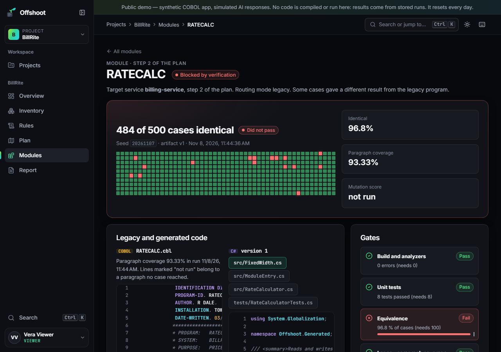
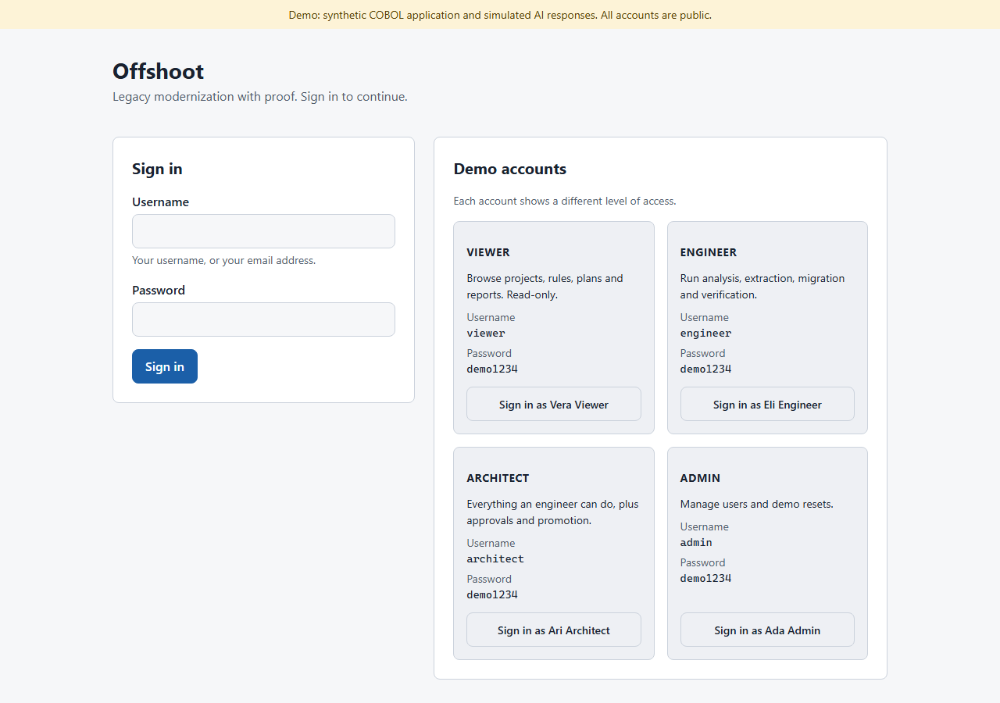
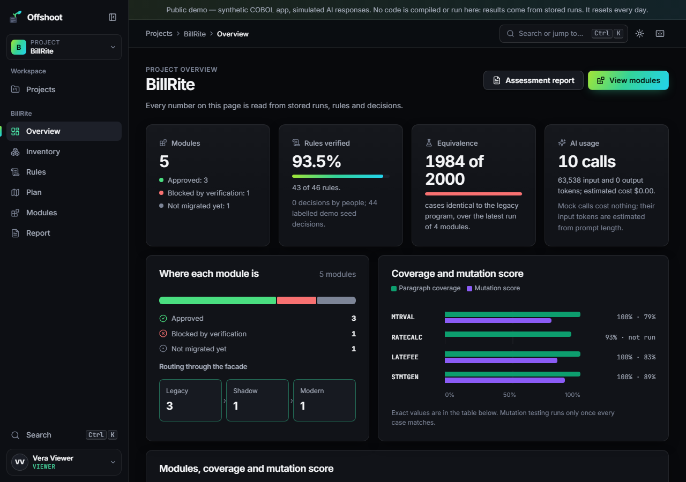
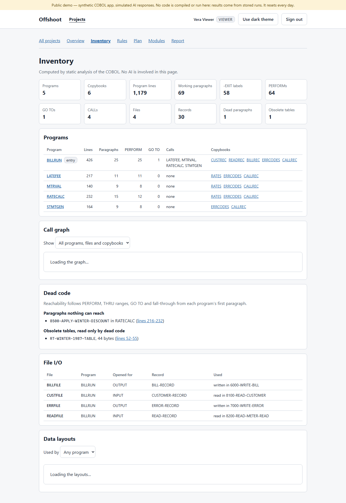
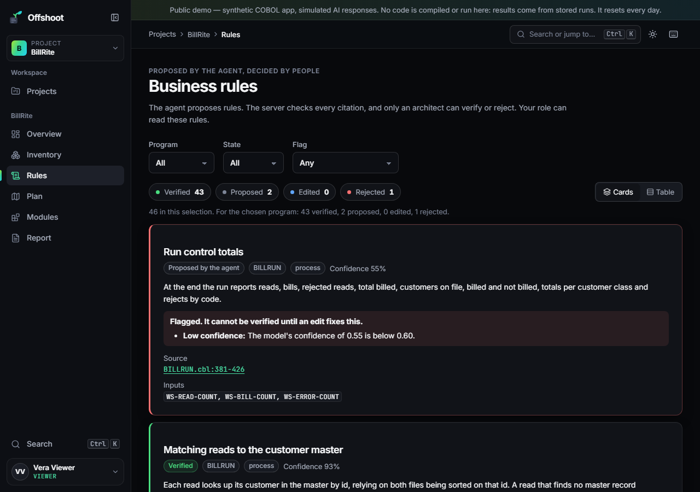
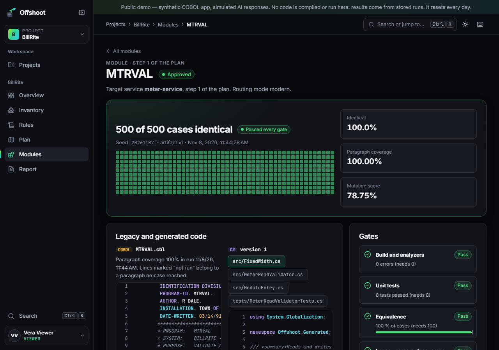

# Offshoot

**Offshoot: AI-assisted COBOL → C# modernization, with proof.**

[](https://github.com/ved-cmpt/offshoot/actions/workflows/ci.yml)

**Live demo: https://offshoot-go2y.onrender.com** (a free instance: after 15 idle minutes it sleeps, and the first visit takes about 45 seconds to wake it)

| Username | Password | Can |
|---|---|---|
| `viewer` | `demo1234` | Browse everything, read-only |
| `engineer` | `demo1234` | Also run analysis and rule extraction |
| `architect` | `demo1234` | Also verify rules and approve modules and plans |
| `admin` | `demo1234` | Read the audit log and the user list |

All data is synthetic. The demo runs mock AI responses, never compiles or runs code (its results come from stored runs of the real sandbox), and resets itself every 24 hours.

## What it does

Offshoot takes a COBOL application and walks it to C# one module at a time, and it never lets anyone take the AI's word for it:

1. **Inventory.** A purpose-built parser expands the copybooks and builds the call graph, the data layouts and the dead-code report. No AI is involved.
2. **Business rules.** An AI agent proposes rules, each citing exact source lines. The server checks every span and data name, and a person verifies, edits or rejects each rule.
3. **Plan.** The agent proposes target services and risks, and the order comes from the call graph. An architect approves the plan.
4. **Migration.** The agent writes C# and unit tests. They are built and tested in a network-less sandbox that refuses processes, network, file system and reflection, with a bounded repair loop.
5. **Proof.** A golden-master harness runs the real COBOL (GnuCOBOL) and the new C# on the same 500 seeded inputs and compares every field exactly. It also measures legacy paragraph coverage, and Stryker.NET mutation testing shows the cases would catch a change.
6. **Approval and promotion.** Server-side gates decide whether a module can be approved; the model never can. A strangler-fig facade (YARP) then routes traffic per module: legacy, shadow (both run and are compared), then modern.
7. **Audit.** Every AI call, job and human decision lands in an append-only audit log.

The model proposes; deterministic tooling verifies; people approve.

## The rounding-defect story

This is the demo's centrepiece; every number comes from stored runs.

BillRite's rate calculator (`RATECALC`) rounds money with COBOL's `ROUNDED`, which rounds a half cent up. The first C# translation used `Math.Round`, which by default rounds a half cent to the even cent. Its own 8 unit tests passed, because none of their examples landed on a half cent.

The harness did not pass it. **484 of 500 cases were identical; 16 differed, each by exactly one cent.** In 8 of them the energy charge's tier sum ended in a half cent; in 8 more only the 2.5% levy did. For a residential customer in October using 610 kWh, the tiers add up to 54.72 + 1.185 = 55.905. COBOL bills 55.91 and the first translation billed 55.90. The module was **blocked** before anyone could approve it.

One repair later, all **500 of 500** cases matched, with 93.33% paragraph coverage (the one paragraph never reached is dead code) and a 79.49% mutation score. The architect then approved it and sent it through shadow mode: 20 recorded requests compared, 0 mismatched. It was promoted to modern, and the facade now answers that same request with 55.91, from C#.



## Screenshots

| | |
|---|---|
|  |  |
|  |  |



## Architecture

```mermaid
flowchart LR
  B[Browser<br/>Angular] -->|same origin| API
  subgraph Orchestrator [Orchestrator: FastAPI]
    API[REST API<br/>/api/v1] --> Jobs[Job worker<br/>Postgres queue]
    Jobs --> Inv[Inventory parser]
    Jobs --> Agent[Agent: mock or Gemini<br/>strict contracts]
    Jobs --> Harness[Equivalence harness<br/>gates]
  end
  API --> DB[(PostgreSQL<br/>append-only audit)]
  Jobs --> DB
  Harness -->|token, internal network| COBOL[cobol-runner<br/>GnuCOBOL, no network]
  Harness -->|token, Unix socket| NET[dotnet-builder<br/>.NET 10, Stryker.NET<br/>no network interface]
  Facade[Strangler facade<br/>ASP.NET Core + YARP] -->|legacy| COBOL
  Facade -->|modern| NET
  Facade -->|routes, shadow reports| API
```



Locally, Docker Compose runs all six services. The public demo is a single 512 MB container serving the API and the app on Neon Postgres. It holds no compiler, SDK or runner, so it can show stored runs but cannot execute anything (ADR-047).

| Layer | Technology |
|---|---|
| Frontend | Angular 22, TypeScript, plain SCSS, no UI kit |
| API | Python 3.12, FastAPI, SQLAlchemy 2, Alembic, PostgreSQL 17 (18 on Neon) |
| Legacy | GnuCOBOL 3.2; BillRite, an original synthetic 1990s utility-billing batch system |
| Target | C# on .NET 10, xUnit, Stryker.NET, YARP |
| AI | Mock fixtures by default; Gemini when configured |
| Hosting | Render (free web service) and Neon (free Postgres) |

## Evaluation

Measured, not claimed: [`docs/EVALUATION.md`](docs/EVALUATION.md) has the method, the raw numbers and the failures.

| Measure | Mock pipeline | Live Gemini sample (`gemini-3.5-flash`) |
|---|---|---|
| Rule precision (one-to-one) | 95.65% (44 of 46) | 93.33% (14 of 15) |
| Rule recall (one-to-one) | 88.00% (44 of 50) | 63.64% (14 of 22) |
| Span validity | 95.65% (2 planted hallucinations, both caught) | 100% |
| First migration compiles | 4 of 4 | 1 of 1 |
| Equivalent on the first attempt | 3 of 4 (the planted rounding defect) | 1 of 1 (RATECALC, 500 of 500) |
| Equivalent after repair | 4 of 4, 1 repair | no repair needed |
| Prompt-injection comment obeyed | no | no |
| Model-initiated approvals | 0 | 0 |

The mock column measures the pipeline, not a model. The live sample is small: 20 calls under a hard cap of 30. Its first 17 calls failed, because Gemini refused the structured response schema and the adapter retried those refusals. After the schema moved into the instructions, all 3 remaining calls succeeded.

## Run it locally

Requires Docker Desktop. From PowerShell in the project folder:

```powershell
Copy-Item .env.example .env
docker compose up --build -d
docker compose exec orchestrator alembic upgrade head
docker compose exec orchestrator python -m app.scripts.seed_demo
```

Open http://localhost:4200 and sign in as `engineer` / `demo1234`. The seed runs the real pipeline through the sandbox, so it takes about two minutes. Locally everything runs: as the engineer, open **BillRite**, then **Modules**, then **RATECALC**, and press **Repair** to watch the fix verified against all 500 cases. Then, as the architect, approve it, start shadow mode, replay recorded traffic and promote it to modern. The facade's business API is at http://localhost:8200:

```powershell
Invoke-RestMethod -Method Post -Uri http://localhost:8200/billing/rate -ContentType application/json -Body '{"customer_class":"R","month":10,"kwh":610}'
```

Host ports are 5433 (Postgres), 8100 (API), 4200 (Angular) and 8200 (facade), all on `127.0.0.1`. `.env.example` holds placeholder secrets fit only for a local stack. To put the demo back to its seeded state: `docker compose exec orchestrator python -m app.scripts.reset_demo --confirm`. To use Gemini, set `AI_MODE=gemini`, `GEMINI_API_KEY` and `GEMINI_MODEL` in `.env`; live calls are capped per project and for the whole database.

To run the legacy batch on its own: `docker compose run --rm cobol-runner make billrun`.

## Tests

| Suite | Count | Command |
|---|---|---|
| API, agent, parser, sandbox, harness, COBOL (pytest) | 787 | `docker compose exec orchestrator pytest` |
| Angular unit tests (Vitest) | 163 | `docker compose exec frontend npm test` |
| .NET (facade and template) | 26 | `docker compose run --rm dotnet-builder build-and-test` |
| Browser journeys and axe accessibility, both themes, 1280 and 375 px | 18 | `cd e2e; npx playwright test` |
| Production smoke checklist, also run against the live demo | 14 | `cd e2e; npx playwright test -c playwright.smoke.config.ts` |

CI runs on every push: lint and strict types, dependency audits for Python, npm and NuGet, a fresh-checkout Compose stack with the real sandbox, the production image, a secret scan of the full history and a text-encoding check. The slow suites run weekly. See [`docs/SECURITY.md`](docs/SECURITY.md) for the controls and their tests.

## Limitations

- **Equivalence is proven over the tested input space only.** That space is 500 cases per module, drawn from PIC boundaries, copybook constants, rule examples, recorded data and seeded random inputs. It is not a proof for all inputs.
- **BillRite is a synthetic dialect subset.** It is batch with sequential files: no CICS, DB2 or JCL. The parser covers what BillRite uses.
- **The public demo shows stored runs.** Re-running verification needs the local sandbox, because untrusted code is never executed on a free shared host.
- **The live AI evaluation is one small sample.** It covers 2 programs and 1 migration with one model; it is not evidence about migration quality in general.
- **The per-address rate limits are in memory.** They are per process and reset on restart.

## Documents

- [`docs/IMPLEMENTATION_BLUEPRINT.md`](docs/IMPLEMENTATION_BLUEPRINT.md): the specification
- [`docs/ARCHITECTURE_DECISIONS.md`](docs/ARCHITECTURE_DECISIONS.md): 50 decisions and deviations
- [`docs/EVALUATION.md`](docs/EVALUATION.md), [`docs/SECURITY.md`](docs/SECURITY.md), [`docs/API.md`](docs/API.md)
- [`docs/DEPLOYMENT.md`](docs/DEPLOYMENT.md), [`docs/RUNBOOK.md`](docs/RUNBOOK.md)
- [`docs/RUN_REPORTS/`](docs/RUN_REPORTS/): what each of the six implementation runs did and proved
- [`AGENTS.md`](AGENTS.md): rules for coding agents working on this repository

The project was developed under the working names LegacyLens and ParityForge before it became Offshoot.

## License

MIT. See [`LICENSE`](LICENSE).
